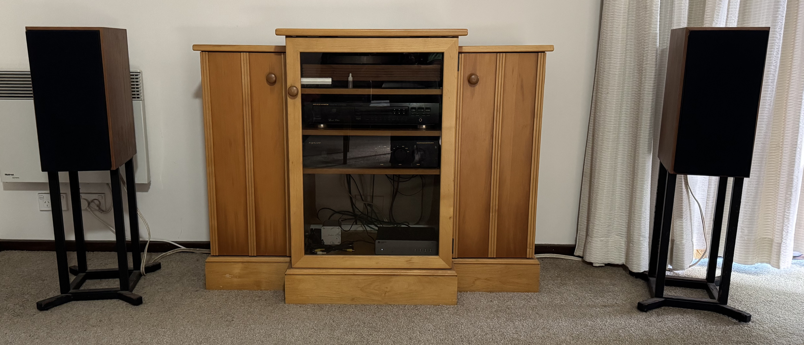

# Chassis Fit 

## Dimensions and characteristics of Cabinet 

- Internal width: 505 mm 
- Internal height: 430mm (to underside of shelf above holding CD)
- Cabinet depth: 450mm 
- Distance from cabinet rear to wall: 65mm (current position)
- The front of the cabinet has a glass swing door that blocks airflow from the front.
- The rear of the cabinet has been cut out, so it is open for ventilation.
- The top turntable shelf thas a rear hole of 50mm and a 4mm gap around the lid perimeter    

I'm seeking to get the best out of the speakers, so prefer to go dual mono if I can, to get the better channel separation.

##  Double chassis (separate monoblocs)

With 430mm height in the cabinet, 2 x 3U monoblocs leaves 170mm height for ventilation.
That might be distributed as 30mm under the base monobloc, 50mm between them, and 90mm above the top one.
It doesn't sound generous. 

For airflow, I would support the upper monobloc on a frame above the lower one, rather than a full width and depth shelf.
The frame would straddle the lower monobloc, bearing on the cabinet base. 

The build guide says "Monoblocks are best reserved for builders who deliberately want separate amplifiers, have room for two chassis, and accept the extra cost and duplicated mains wiring." 

I like the idea of the optimal architecture, but it is more work and cost to build, and has the concern that there might not be enough air gap for ventilation.
The optimal and usual way to use monoblocs is to put them next to the speakers, but I'm not doing that, so I'd not get much benefit from separate chassis. 

It may be fine thermally, partnered with a 50VDC (low heat output) variant of the Wolverine, but I don't know of a way to be sure about it in advance.  

### Single chassis (full Dual Mono - 2 transformers)

A multi-layer build with 2 stacked transformers (true dual mono) should work in principle.
The problem is fitting it all in.

It might need a 5u chassis to get the height to fit 2 transformers.
The Parker cabinet can accommodate a 5U chassis, leaves 208mm vertical gap, ample for ventilation.

I'd originally thought it would be more difficult than a shared transfomer, but it probably isn't for me.
It does mean more mechanical support, but as that's an area I'm strong in, it's not really a risk.
Because it uses 2 half size transformers (eg 2 x 400 vA) the floor area is reduced compared to one big one.

I should look more into this.  

## Single chassis (partial dual mono, shared transformer)

The 4U chassis fits in the cabinet with 259mm vertical gap for feet and overhead ventilation, and 27mm to the sides. 
That's a lot better than 2 chassis - so much space that ventilation doesn't sound like it would be a problem.

The build guide says: "As a practical rule, choose the simplest layout that meets your actual need. A cleanly built shared-supply stereo Wolverine is usually preferable to an overcrowded dual-mono build or a pair of monoblocks built only because they seem more impressive." 

I don't want to be overcrowded, but want to explore the options for dual rather than going straight for a stereo build.
One way to get more space is to use a shared transformer, with independent windings.
That isnt true mono, but saves a lot of chassis base space, and probably gets most of the dual mono benefits. 
It means a custom transformer, so there will be a cost penalty.
So far I've focused on this one.

## Layout

- Top fixed (turntable) shelf of cabinet: MNX10 Streamer and Preamp (side by side).
- Second shelf: CD player
- On base of Cabinet: Stereo Wolverine power amp

## Wolverine Chassis Details (assuming partial dual mono, shared transformer )

- Modushop Dissipante **4U, 400mm depth** Black.  
- Front 10mm aluminium, aluminium covers.
- Width 450mm, height = 171mm (without feet)
- The standard "Deluxe diyAudio" rear plate would suit me very well.

### Preamp Chassis

I will use a Modushop Galaxy 2U half width chassis for the Preamp (height = 80mm)
This fits the Mezmerize PCB intended for this chassis (200.5 × 68.6 mm) with enough extra depth to facilite a neat build

- Modushop Galaxy  **2U, 230mm wide x 280mm depth** Black
- Front 10mm aluminium, aluminium covers, height = 80mm (without feet)
- The preamp and streamer will fit side by side with 60mm gap. (Cabinet 450mm, MXN10 215 mm wide)
