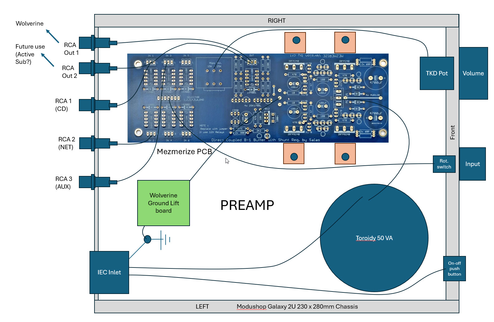

# Mezmerize preamp Options

- Mezmerize standard '10 years after' B1 buffer PCB, running 200 mA,
- Chassis Modushop Galaxy 2U, 230mm wide x 280mm depth.  Aluminium cover.
- Provision for 3 line level audio inputs (CD, NET, and AUX)
- Rotary switch for input with 60 deg throw; Greyhill 50D60-01-1-AJN (6.35mm shaft)
- Input Knob Modushop 25mm black. (drill out to fit 6.35mm)  
- Push Button On off, latching, EAO series 82-5151.2116.  19mm, Illuminated Red ring (230VAC for LED)
- 5 pairs RCA connectors with integrated Teflon or POM isolation washers. eg Neutrik REAN NYS367 (3 input pairs, 2 pair outputs to power amp & sub)
- Toroidal transformer 50 VA, 2 × 15 V
- LSK170 transistors - prematched Linear systems 8-11 mA Quad set from diyAudio store. (plus 6 others that don't need to be matched)
- IEC mains input, flange mount with integrated fuse holder Schurter 4304.6020 
- T315 mA slow blow fuses
- Potentiometer TKD 2CP-2511 (20kΩ Logarithmic)
- Volume knob - Modushop 40mm black.
- Print colour D0D0D0 in RGB - light silver. 

