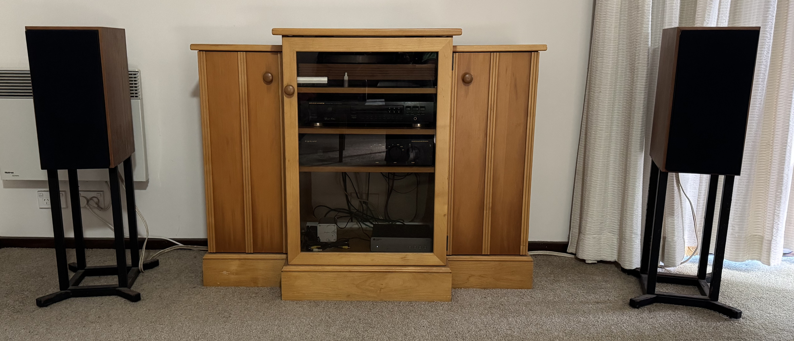
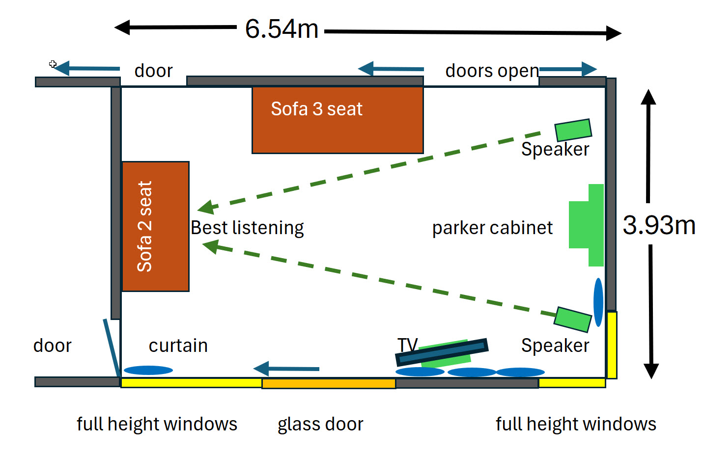

# Objectives

## Site Objective

- To document the thinking process behind my amplifier system design
- To let others access this so they can help my design if they so wish
- Let others know how I've been thinking - whether this might help them I don't yet know.

## Amplifier Objective 

To restore the musicality I experienced from the 100W amplifier (now no longer operating) that my neighbour designed and built for me years ago, specifically tailored to my VAF i91 speakers. 

To surpass the fall-back amplifier that I am currently using, my Exposure Super XV (40W).

 
 
 

## Key objectives and constraints:

- Preamp (Mezmerize) plus power amp(s)
- Approach: "if it is worth doing, it is worth doing well"
- Timeline: Goal 12 months but no hard limit.
- Budget: Ample, no hard limit.
- Partner with VAF i91 mk1 loudspeakers and deliver their full potential, as far as practicable. (nominal impedance 6Ω, sensitivity 88 dB/W/m)
- On preamp, provide 3 line inputs, one for my MXN10 streamer (NET), my CD player (CD), and a spare (AUX).
- Build a reliable premium well engineered system, avoiding excessive complexity.
- Professional level finish - low key, unobtrusive.
- Avoid domestic disharmony, fit all HiFi chassis into our Parker HiFi cabinet (space for amps 430mm (h) x 505mm (w) x 450mm (d) - open back so ample depth to wall behind)
- Speakers are close to cabinet (2m cables) 
- I like the idea of dual mono if possible, no fixed constraint on how that might be done.

## Secondary Objectives

Be compatible with the sorts of upgrades that might happen (though not likely in the short term):

- SEAS-NEXTEL-2F speakers (semi-active or passive). Impedance: 4-8 Ohms, Sensitivity: 88 dB/W/m 
- Upgrade my streamer (MXN10), possibly to something that supports Dirac live room correction such as a Bluesound Node Icon 

Neither of these are likely to change the power amplifier needs, but a second output pair on the preamp might be needed.

## Personal Objectives

Now that I am retired, this project lets me engage again with the technical thinking that has always felt satisfying.
Whilst I have an engineering background, it isn't in electronics, so this project will give me a challenge. 

### Why the Wolverine Topology

- My VAF i91 speakers are said to benefit from an amplifier that maintains composure and grip.
- The Wolverine amplifier combines technical excellence with musicality so should be able to deliver that.

### Why the Mezmerize B1 Buffer Pre‑Amplifier

- The Mezmerize B1 TYA (ten years after) delivers a clean signal with good impedance behaviour
- It is expected to complement the Wolverines.

 
