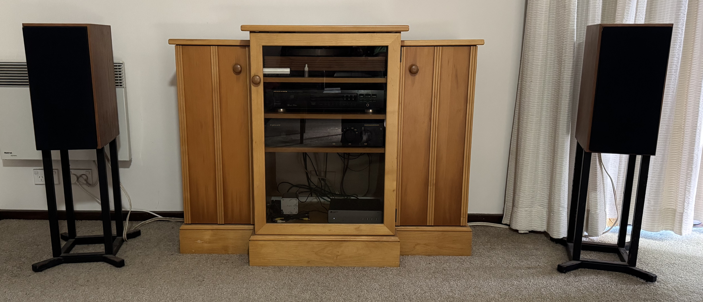
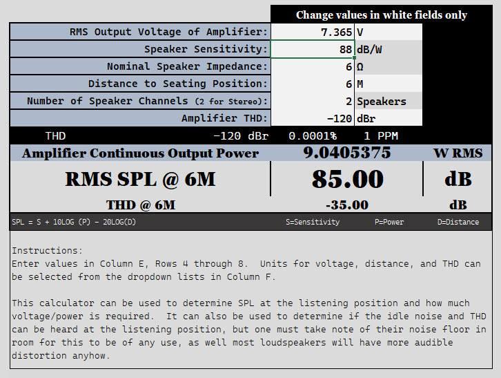
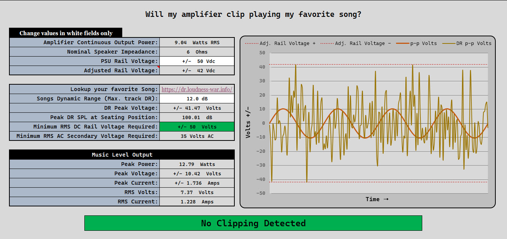

# Power selection and constraints

## 1. Amplifier options

My HiFi is currently housed in a Parker cabinet,

For domestic harmony, I need to maintain or improve the look of the lounge room.

I haven't found a better alternate so the amplifier must go in the existing Parker cabinet.

The DiyAudio forums contain many cautions about placing Wolverine amplifiers in cabinets, and comments on the unpredictability of cooling depending on the exact placement.

The cabinet has an open back, but airflow is restricted so the Wolverine amplifier variant selected must be of relatively low heat output.

## 2. Power match with VAF i91 speaker

All Wolverine listed options are 100W or more.  My 40W per channel Exposure Super VX integrated amp drives my VAF i91 speakers with plenty enough volume for me, so all options will have enough power. 
I'm upgrading for hoped gains in sound quality, not sound level (volume).  

## 3. Selection of Wolverine EF3-n model and rail voltage

The Wolverine amplifier comes in variants EF3-3, EF3-4 and EF-3-5.  I select the **EF3-3** variant as it generates the least heat.

I also must select rail voltage.  Higher rail voltages increase output capability, but also generate more heat. They also increase how loudly the amplifier can play, with a given speaker.
I've used the spreadsheet "SPL and Rail voltage calculator.xls" to estimate what I need.

I'm listening at a distance of 6m, my VAF i91 mk1 speakers are 88 dB/W and 6 ohm nominal impedance. I'll set my maximum SPL as 85 dB, the generally accepted OHS safe threshold for prolonged sound exposure.  (too loud for me but I'll use it as a starting point)

Entering values of RMS output by binary search, I find that an 7.365 V RMS output gives 85.00 dB RMS SPL at 6m.

Moving to the Clipping calculator, with a song having 12 DB dynamic range (slightly more than typical), it tells me that I need minimum 50V DC rail.

I note that is generating 100 dB SPL at the dynamic peaks.  In practice, I'd not expect to tolerate anywhere near that level, I'd turn the volume down.

I set my Exposure amp playing at a slightly higher level than my usual level, and used the “Decibel X” app to measure SPL on a mix of rock and classical.

My average was 71.1 dB SPL, maximum SPL level on a peak was 85.3 dB. It was somewhat fatiguing at this level, I'd play it quieter normally.  

So the amplifier at 50 VDC is more than enough, as it can run 85 dB SPL continuous and 100dB SLP peaks without clipping.

## 4. Determination of Secondary voltage and Transformer VA

The build guide gives this advice for 2 channels at 4 ohms  (rearranged and culled to ignore high power variants)

| DC rail| Typical VA | 8Ω power W | AC V |
|--------|------------|------------|------|
|   49   |     500    |   100      |  35  |
|   49   |     600    |   120      |  35  | 
|   54   |     600    |   120      |  38  |
|   54   |     700    |   150      |  38  |
|   57   |     700    |   150      |  40  |
|   57   |     800    |   160      |  40  |

I'll look at what happens with the 35 V AC. My mains supply ranges from 230V AC to 240V AC. 

Using a transformer designed for a 230V primary and 35VAC secondaries (Vac) then for different mains voltages: AC voltage Vacr = Vac * Vmains/230 and rail voltage Vdc = Vacr * sqrt(2) 

| V mains | V acr  | V dc   |
|--------|---------|--------|
|   230  |  35.00  |  49.5  |
|   235  |  35.76  |  50.6  |
|   240  |  36.52  |  51.6  |

So buying a 230 VAC transformer with 35VAC secondaries will mean I'm averaging a 50.6VDC rail.  

The table suggests a total of 600 VA transformer is sufficient. Larger transformers run cooler, so I'll err towards the larger end. I note that a Toroidy 800VA is the same size as the 600VA, and if I use 2 transformers instead, the 400VA is the same size as the 300VA. 

So I pick 800 VA total with 35 V AC secondaries.

## 5. Mitigation for systemic overheating - Wolverine

I've decided to sell my turntable (Linn LP12 with SME IV arm), as I'm no longer using it.  
This allows me to move other components upwards, in turn giving more ventilation space in the cabinet (which has an open back)

I will build the preamp as a half width unit, so it can go in the turntable space with my half-width streamer.
This leaves a bigger free space for the power amplifier below.

Other things I might try if needed are:

- Move the cabinet forward to increase the gap at the wall from 65mm to something bigger.
- Moving the cabinet door forwards by putting the hinges on pads, to create a 10 mm perimeter gap.
- Removing the cabinet's glass door. (subject to the domestic harmony test)
- Fan blowing upwards from the base of the cabinet past the amplifiers (last resort)

# 6. Preamp Power Requirements

I plan to build a standard "10 years after" Mezmerize.  

This is designed to run at 200mA and the official Salas BOM nominates a 50vA , 2 x 15 V transformer. 

The intended placement in the turntable area has limited ventilation.  If it gets too hot, the cabinet top lid gap can be increased. 