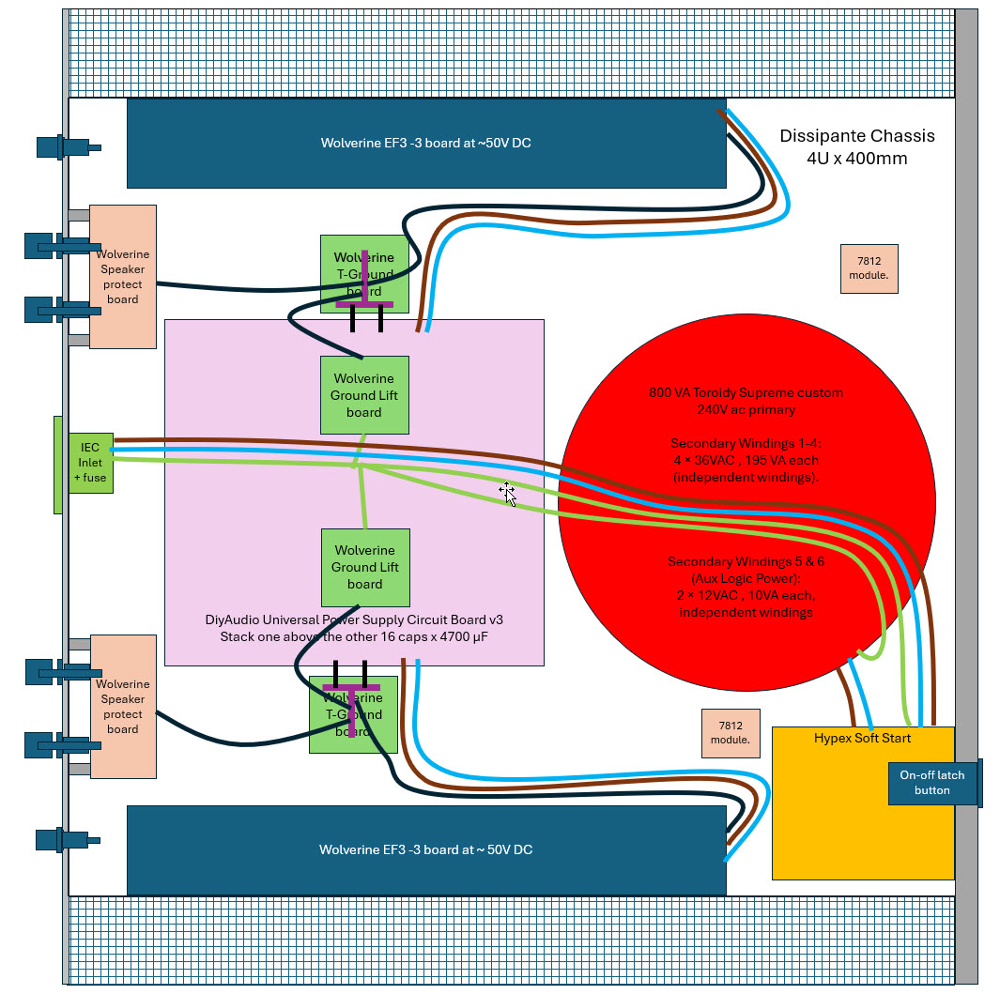

# Wolverine 2 transformer option

This is a high level summary for the option with Dual mono separate transformers in one chassis

The reason to consider this is that it separates the channels further.
Stacked smaller transformers, allows more distance between the power area and the outputs, for less risk of problems with hum etc.

This is more a snapshot, rather than locked in stone -  it has been changing as I learn things.

- EF3-3 with 50V DC rails. 
- 10kΩ input configuration.  
- Dual mono, single chassis 2 transformer build.
- 2 x 400 VA transformers, each with 2 x 36V AC and 12V 10vA Aux independent secondary (Toroidy audio Supreme custom)
- Chassis Modushop Dissipante 5U, 400mm depth, DIY audio Deluxe version (extra height of 5U allows stacking of transformers)
- 2 x Speaker protection boards (wolverine option monitoring short circuits and managing the 65°C thermal warning loop). go for Mosfet version of parts.
- Power speaker protection boards from separate regulated 12VDC auxiliary PSU's, each fed from a 12VAC transformer auxiliary winding
- 2 x 12V dc power regulator module for speaker board e.g Kiro&Seeu 7812-MD-1P - or home built?
- 2 x Ground lift boards (wolverine option)
- 2 x T-Ground boards (wolverine option)
- 2 x Dual bridge rectifier boards (wolverine option)
- Caps mounting - home built for screw caps, or other compact option TBD.
- Caps capacity: Targeting about 80000 uF
- thermal Safety Switches: One TO-220 style bimetallic switch per heatsink (e.g 65°C NC Sensata / Airpax 67L065 for the Wolverine board).
- Soft start: Hypex (purchased, in transit)
- IEC mains input, flange mount with integrated fuse holder Schurter e.g 4304.6020 and switch
- 4A Slow-Blow (Time-Delay / "T" rated) 5x20mm fuse.
- Push Button On off, latching, illuminated red ring, e.g  EAO 82-5151.2113  (12V LED) or E-Switch PV4F23011-3R4
- Output transistors,  Onsemi 6 x NJW0281G and 6 x NJW0302G from Mouser (but buy 8 pairs)
- 2 RCA connectors, insulated
- 4 speaker binding posts  

