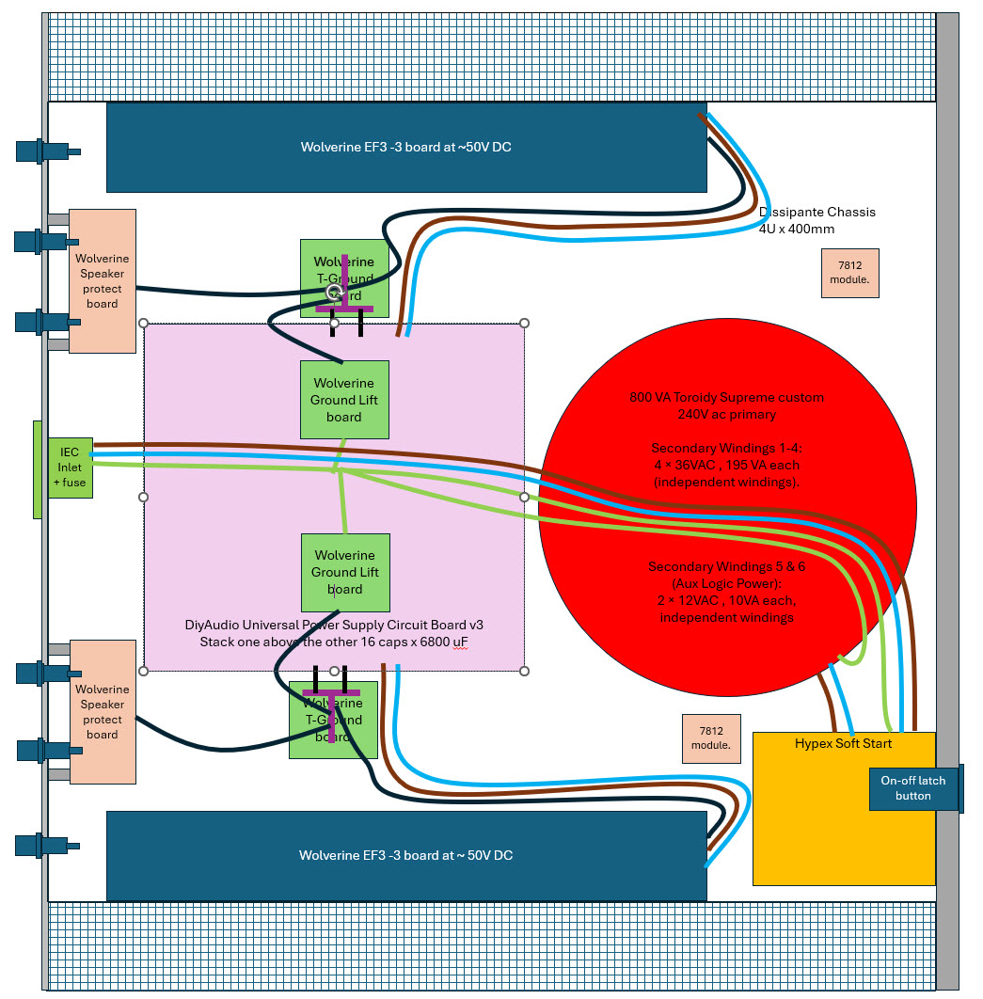

# Wolverine shared transformer option

This is a high level summary of the main features being considered (assumes the dual mono shared transformer configuration)

This is more a snapshot, rather than locked in stone -  it has been changing as I learn things.

- EF3-3 with 50V DC rails. 
- 10kΩ input configuration.  
- Dual mono, single chassis build.
- 800 VA custom transformer with a 4 x 36V AC 192 VA and 2 x 12V 10vA independent secondaries 
- Chassis Modushop Dissipante 4U, 400mm depth, DIY audio Deluxe version
- 2 x Speaker protection boards (wolverine option monitoring short circuits and managing the 65°C thermal warning loop). go for Mosfet version of parts.
- Power speaker protection boards from separate regulated 12VDC auxiliary PSU's, each fed from a 12VAC transformer auxiliary winding
- 2 x 12V dc power regulator module for speaker board e.g Kiro&Seeu 7812-MD-1P 
- 2 x Ground lift boards (wolverine option)
- 2 x T-Ground boards (wolverine option)
- PSU undecided. 2 stacked diyAudio PSU v3 boards does fit but is bulky, has the caps closer to the sensitive bits than I'd like. Doesnt seem right. look for alternatives   
- Caps: If using two PSU v3 boards, 16 x 4700 uF 35mm Ø x 30mm high Nichicon LLS 80V rated  (75200 uF total)
- thermal Safety Switches: One TO-220 style bimetallic switch per heatsink (e.g 65°C NC Sensata / Airpax 67L065 for the Wolverine board).
- Soft start: Hypex (purchased, in transit)
- IEC mains input, flange mount with integrated fuse holder Schurter e.g 4304.6020 
- 4A Slow-Blow (Time-Delay / "T" rated) 5x20mm fuse.
- Push Button On off, latching, illuminated red ring, e.g  EAO 82-5151.2113  (12V LED) or E-Switch PV4F23011-3R4
- Output transistors,  Onsemi 6 x NJW0281G and 6 x NJW0302G from Mouser (but buy 8 pairs)
- 2 RCA connectors, insulated
- 4 speaker binding posts  

