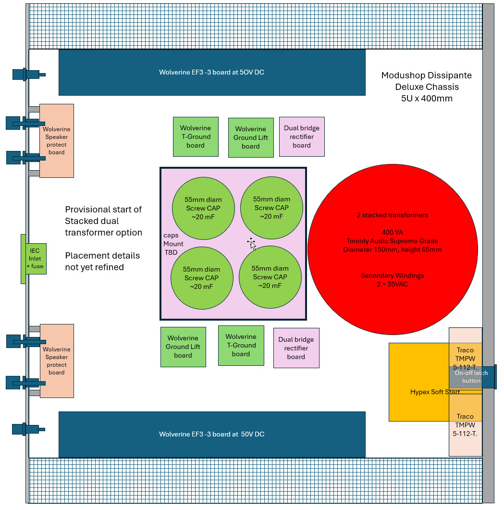
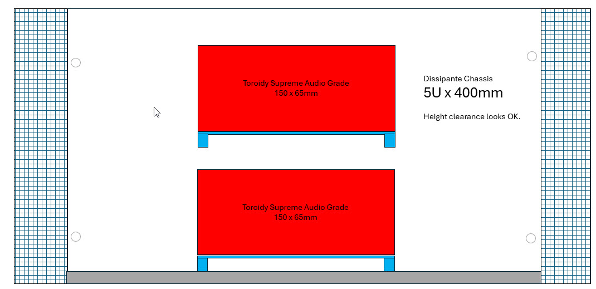

# Wolverine Dual transformer option

This is more a snapshot, rather than locked in stone -  it has been changing as I learn things.

- EF3-3 with 50V DC rails. 
- 10kΩ input configuration.  
- Dual mono, single chassis 2 transformer build.
- 2 x 400 VA transformers, each with 2 x 35V AC secondaries
- Chassis Modushop Dissipante 5U, 400mm depth, DIY audio Deluxe version (5U height allows stacking of transformers)
- 2 x Speaker protection boards (wolverine option monitoring short circuits and managing the 65°C thermal warning loop). go for Mosfet version of parts.
- 2 x 230VAC to 12V dc power regulator module Traco TMPW 5-112-T - to drive speaker protection boards
- 2 x Ground lift boards (wolverine option)
- 2 x T-Ground boards (wolverine option)
- 2 x Dual bridge rectifier boards (wolverine option)
- Caps mounting - 4 x screw caps, each about 20000 uF
- thermal Safety Switches: One TO-220 style bimetallic switch per heatsink (e.g 65°C NC Sensata / Airpax 67L065 for the Wolverine board).
- Soft start: Hypex 
- Push Button On off, latching, illuminated red ring, e.g  EAO 82-5151.2113 (12V LED) 